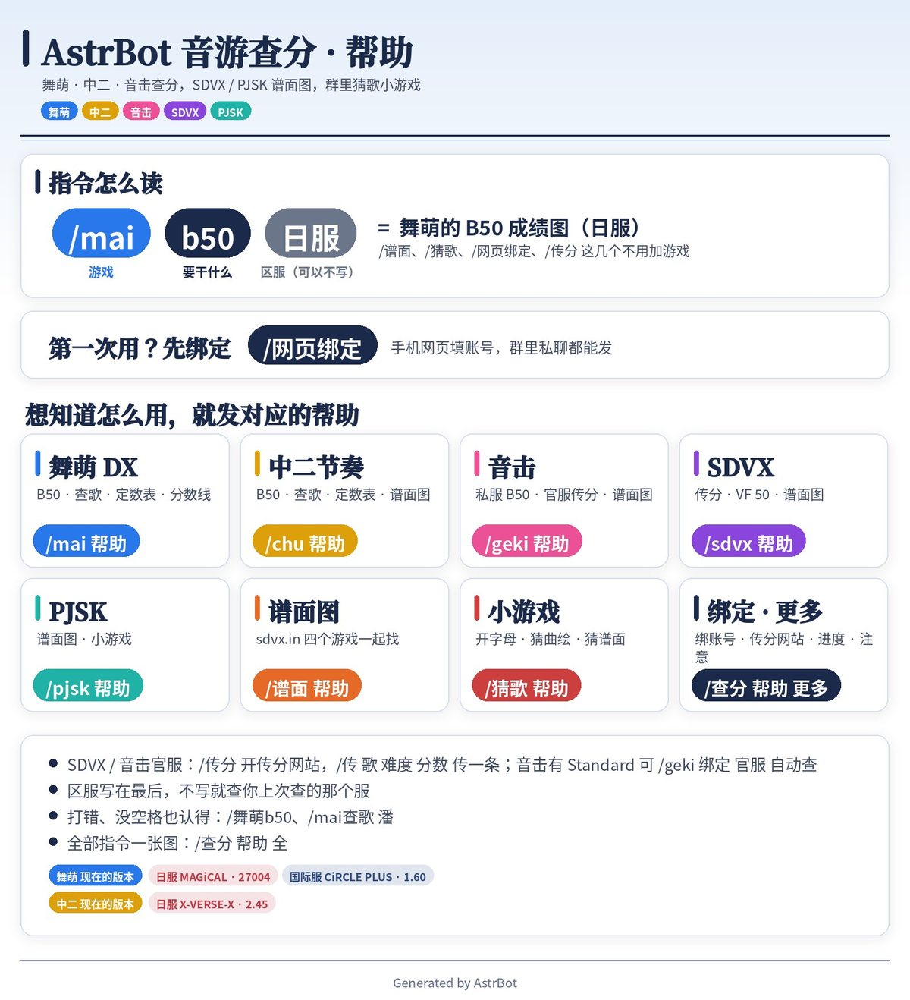
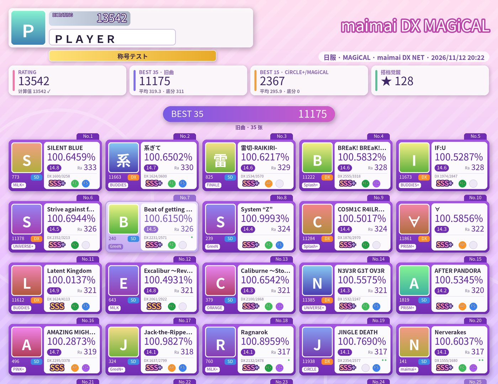
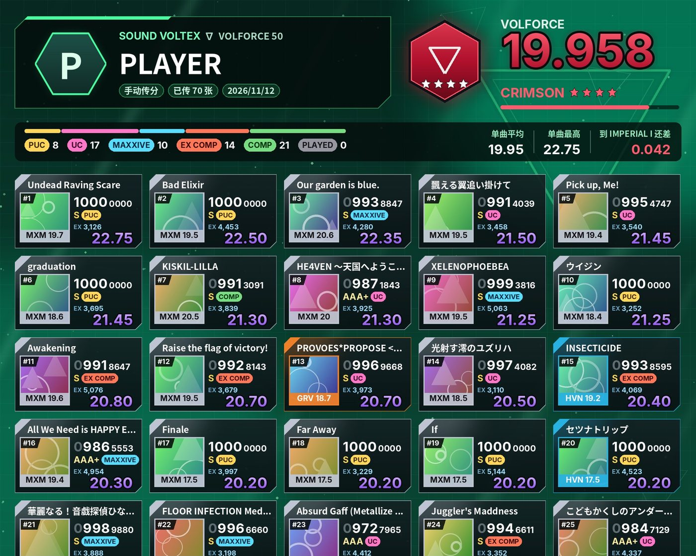
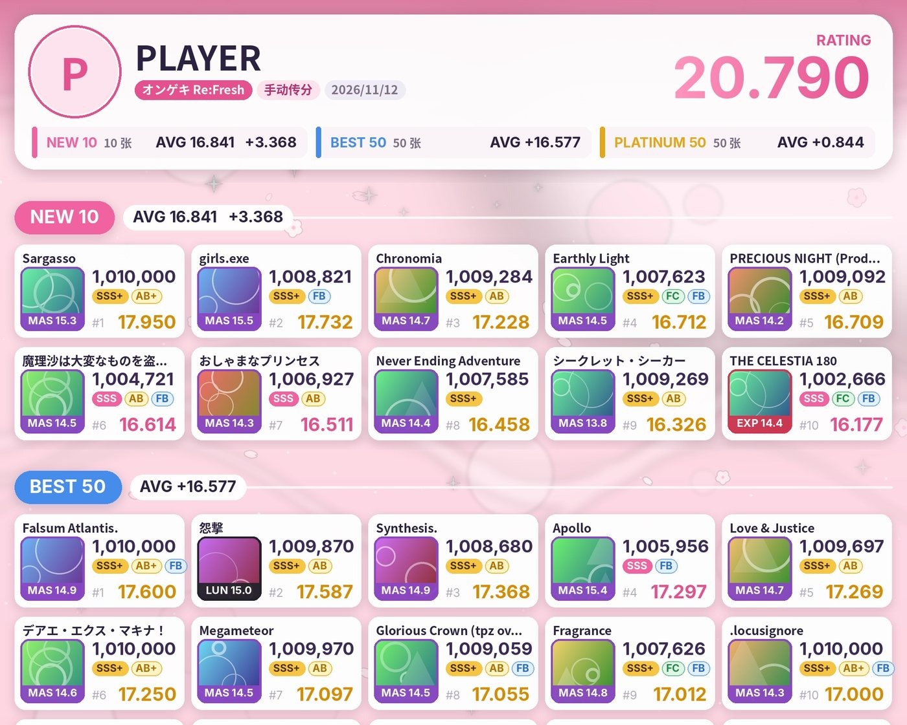
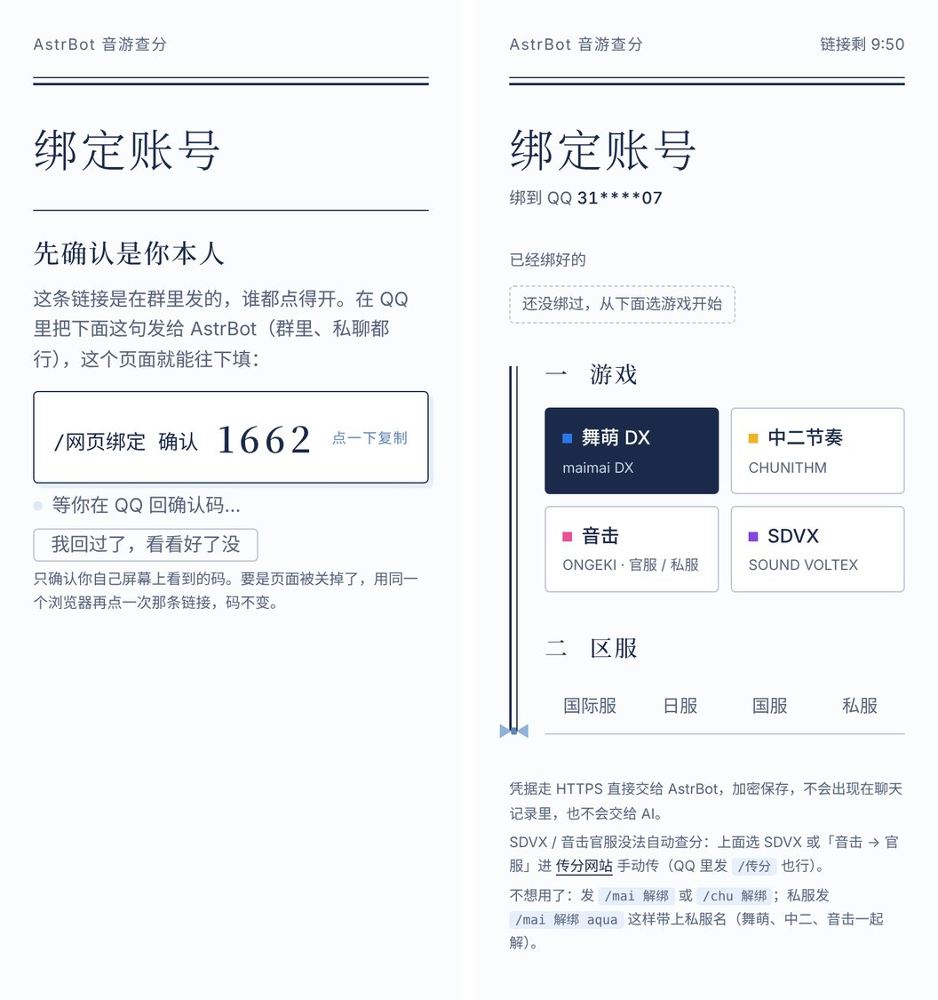
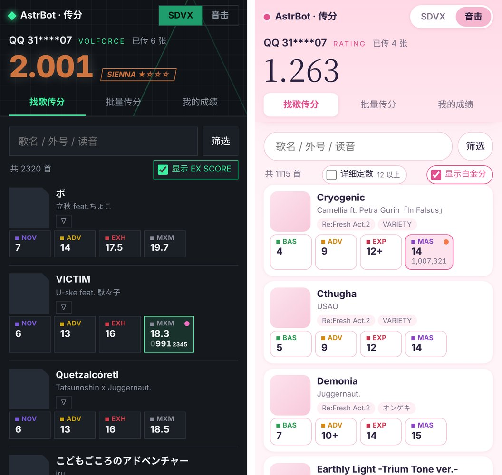
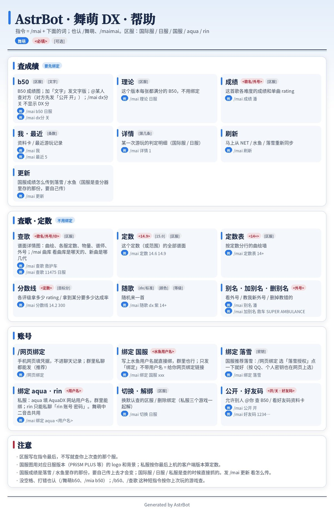
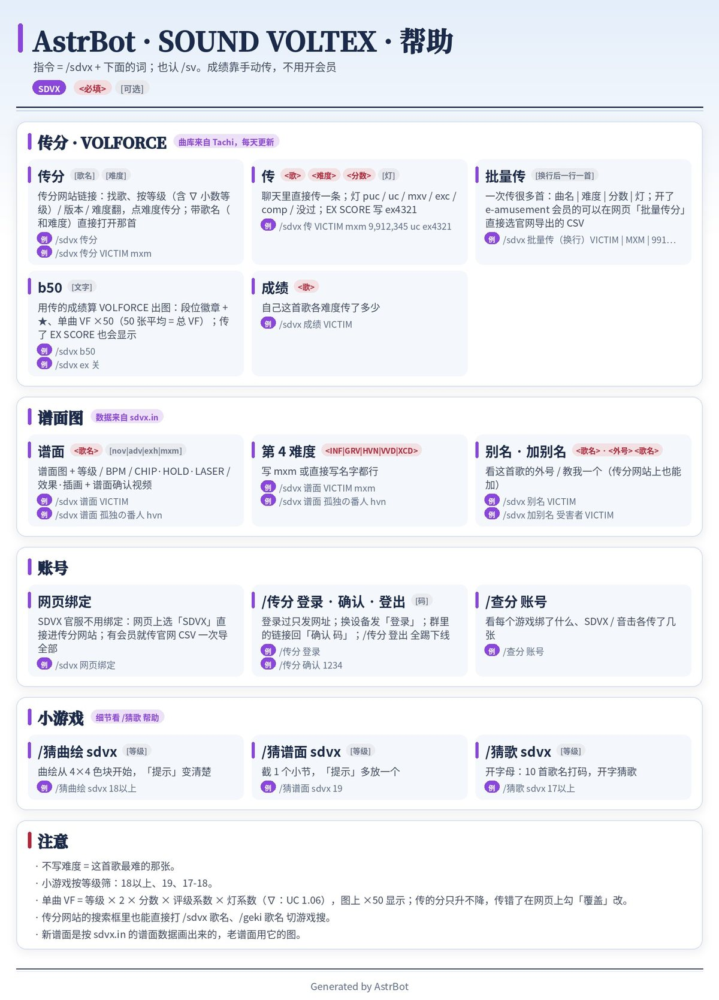
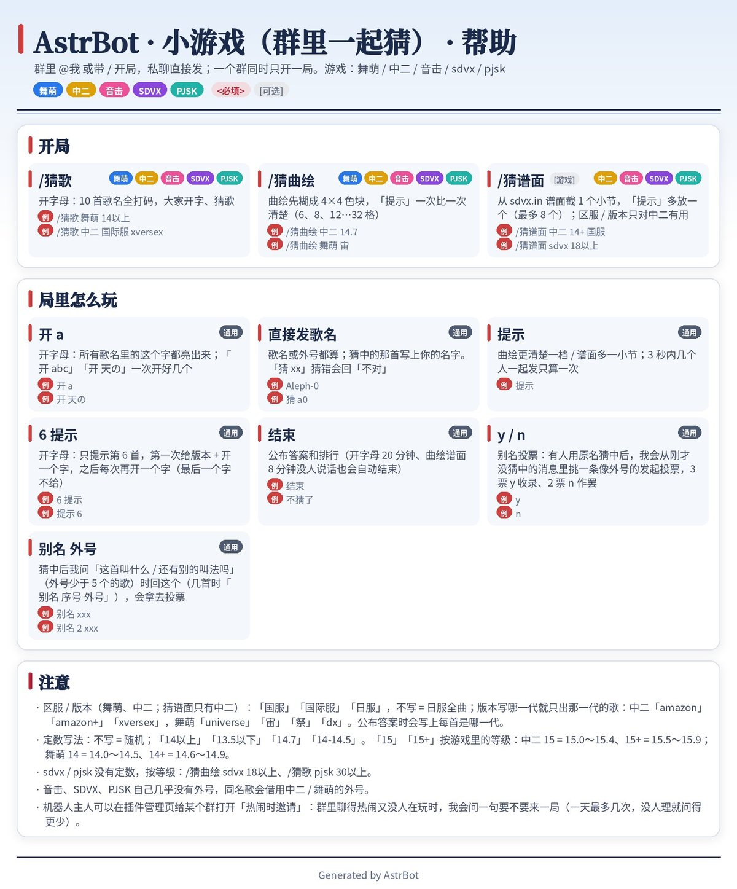
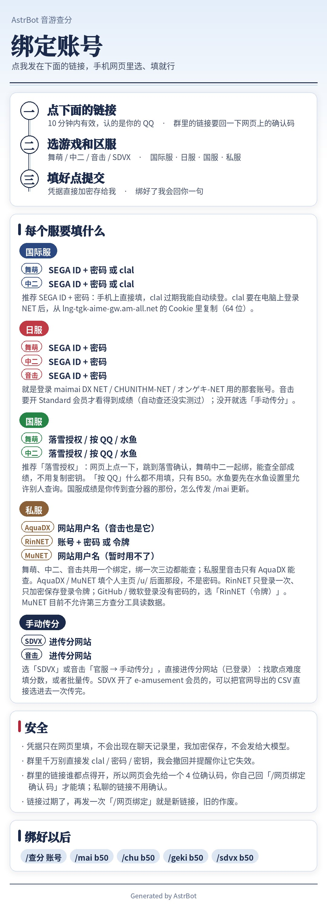

# 音游查分 · astrbot_plugin_otoge_prober

给 [AstrBot](https://github.com/AstrBotDevs/AstrBot) 用的街机音游查分插件：在 QQ 里查舞萌 DX、中二节奏、音击、SOUND VOLTEX 的成绩，看谱面，和群友猜歌。

## 目录

- [能做什么](#能做什么)
- [支持的游戏和区服](#支持的游戏和区服)
- [长什么样](#长什么样)
- [安装](#安装)
- [五分钟上手](#五分钟上手)
- [指令速查](#指令速查)
- [网页绑定](#网页绑定)
- [传分网站](#传分网站)
- [群里的小游戏](#群里的小游戏)
- [国服：落雪接入](#国服落雪接入给-bot-主人)
- [常用配置](#常用配置)
- [素材](#素材可选不随插件分发)
- [安全与隐私](#安全与隐私)
- [已知限制](#已知限制)
- [数据来源和致谢](#数据来源和致谢)

## 能做什么

| 功能 | 说明 |
|---|---|
| **成绩图** | 舞萌 B50、中二 B30 + N20、音击新曲 10 + 旧曲 50 + P 分 50、SDVX VOLFORCE 50。rating 按各服自己的定数算。 |
| **查歌** | 带曲绘的谱面卡：各服定数、物量、谱师、外号。定数表、分数线、随机一首。打错字、只打一半、发外号都能找到。 |
| **谱面图** | 中二、音击、SDVX、PJSK 的谱面图和谱面确认视频（来自 sdvx.in）。 |
| **网页绑定** | 发 `/网页绑定` 拿一条 10 分钟有效的个人链接，在手机网页里填账号。密码不进聊天记录。 |
| **传分网站** | SDVX 和音击官服没法自动查，就在网页上自己传分：找歌、点难度、填分数，或者一次贴几十首。 |
| **小游戏** | 群里一起猜歌：开字母、猜曲绘、猜谱面。猜的过程里顺手收集歌曲外号（群投票）。 |
| **大白话查分** | 按群开关。@机器人 说「帮我看下舞萌 b50」「反叛是什么歌」。规则能判断的句子不花 token。 |
| **版本进度** | 每天核对各服当前版本和定数表；版本一变私聊通知机器人主人。 |

更新记录在 [CHANGELOG.md](CHANGELOG.md)，QQ 里发 `/查分 更新记录` 也能看。

## 支持的游戏和区服

| 游戏 | 国际服 | 日服 | 国服 | 私服 |
|---|---|---|---|---|
| **舞萌 DX** `/mai` | ✅ NET（SEGA ID 或 clal） | ✅ NET（SEGA ID） | ✅ 落雪（授权 / 按 QQ / 个人密钥）、水鱼 | ✅ AquaDX、RinNET |
| **中二节奏** `/chu` | ✅ NET（SEGA ID 或 clal） | ✅ NET（SEGA ID） | ✅ 落雪、水鱼 | ✅ AquaDX、RinNET |
| **音击** `/geki` | — | ✅ NET（要 Standard 会员）或手动传分 | — | ✅ AquaDX |
| **SOUND VOLTEX** `/sdvx` | — | ✅ 手动传分（∇ 规则算 VF） | — | — |
| **谱面图** `/谱面` | 中二 · 音击 · SDVX · PJSK，不分区服 | | | |

一个 QQ 号可以同时绑多个服。不写区服时查你上一次查的那个。

## 长什么样

下面的图都是插件自己画的，没有放游戏素材（曲绘位置是自绘的占位色块）。装上[素材](#素材可选不随插件分发)后，评级、FC / AP、版本 logo 会换成游戏里的图标。

| 舞萌 B50 | SDVX VOLFORCE 50 | 音击 B50 |
|:---:|:---:|:---:|
|  |  |  |

| 网页绑定（群里的链接先回确认码） | 传分网站（SDVX / 音击各一套主题） |
|:---:|:---:|
|  |  |

分主题的帮助图、绑定说明图

| `/mai 帮助` | `/sdvx 帮助` |
|:---:|:---:|
|  |  |

| `/猜歌 帮助` | `/网页绑定` 带的说明图 |
|:---:|:---:|
|  |  |

## 安装

1. AstrBot 管理面板 → 插件 → 安装插件 → 从链接安装，填本仓库地址。也可以在 [Releases](../../releases) 下载 zip，用「从文件安装」。
2. 依赖写在 `requirements.txt` 里，AstrBot 会自动装。
3. 装好就能用。发 `/查分 帮助` 看总览。

要用**网页绑定**和**传分网站**，还要把插件开的本机端口（默认 `127.0.0.1:36199`）用反向代理或隧道放到一个 HTTPS 域名上，把地址填进配置 `bind_web_url`。不配的话，绑定可以在私聊里用指令完成，传分可以用 `/传`、`/批量传`。

系统里没有中日文字体时，插件会自动下载思源黑体。

## 五分钟上手

指令的读法是 **`/游戏 动作 [区服]`**：

| 你发 | 得到 |
|---|---|
| `/网页绑定` | 绑定说明图 + 你的个人链接 |
| `/mai b50` | 舞萌 B50 图（查你上次查的那个服） |
| `/mai b50 日服` | 指定区服 |
| `/chu 查歌 反叛` | 中二谱面卡，外号也认 |
| `/sdvx 传分 VICTIM` | 打开传分网站上的这首歌 |
| `/谱面 Aleph-0` | 四个游戏一起找，发谱面图 |
| `/猜歌 舞萌 14+` | 群里开一局开字母 |

游戏名写错（`/mia b50`）、连着写（`/舞萌b50`）、不写游戏（`/b50`）都认。子指令写错会提示「是不是想发…」。

## 指令速查

完整的说明在机器人里：`/查分 帮助`（总览），`/mai 帮助`、`/chu 帮助`、`/geki 帮助`、`/sdvx 帮助`、`/pjsk 帮助`、`/谱面 帮助`、`/猜歌 帮助`、`/查分 帮助 更多`。

<b>舞萌 DX</b> · <code>/mai</code>（也认 <code>/舞萌</code>、<code>/maimai</code>）

| 指令 | 作用 |
|---|---|
| `b50` | B50 成绩图。加「文字」发文字版，@某人 查对方（对方要先 `/mai 公开 开`） |
| `理论` | 这个版本每张都满分的 B50，不用绑定 |
| `成绩 <歌>` | 这首歌各难度的成绩和单曲 rating |
| `我`、`最近`、`详情` | 资料卡、最近游玩、某一次的判定明细 |
| `刷新` | 马上重新同步 |
| `更新` | 国服成绩怎么传到落雪 / 水鱼 |
| `查歌 <歌>` | 谱面卡：曲绘、各服定数、物量、谱师、外号 |
| `定数 <14.5>`、`定数表 <14+>` | 这个定数的全部谱面、按定数分行的曲绘墙 |
| `分数线 <定数>` | 各评级拿多少 rating |
| `随歌` | 随机一首 |
| `别名`、`加别名`、`删别名` | 看外号、教一个新外号、删掉教错的 |
| `绑定 …`、`切换`、`解绑` | 账号管理，推荐用 `/网页绑定` |

<b>中二节奏</b> · <code>/chu</code>（也认 <code>/chuni</code>、<code>/中二</code>）

| 指令 | 作用 |
|---|---|
| `b50` | B30 + N20 成绩图（水鱼是 B30 + R10） |
| `理论` | 理论最高 rating 的成绩图 |
| `成绩 <歌>`、`我`、`最近`、`刷新`、`更新` | 和舞萌一样 |
| `查歌 <歌>` | 谱面卡。只有某一服定数不一样时才列三服对照 |
| `定数`、`定数表` | 和舞萌一样 |
| `谱面 <歌> [紫\|红\|黑]` | sdvx.in 的谱面图 + 三服定数、BPM、物量、谱师 |
| `绑定 …`、`绑定教程`、`切换`、`解绑` | 账号管理 |

<b>音击</b> · <code>/geki</code>（也认 <code>/ongeki</code>、<code>/音击</code>）

| 指令 | 作用 |
|---|---|
| `b50` | 新曲 10 + 旧曲 50 + P 分 50（Re:Fresh 算法） |
| `b50 手动` | 用手动传的成绩出图 |
| `绑定 官服`、`同步` | 网页填 SEGA ID，自动查（要 Standard 会员才看得到成绩） |
| `绑定 aqua <用户名>` | 私服 AquaDX |
| `传分 [歌]`、`传 …`、`批量传` | 手动传分，见[传分网站](#传分网站) |
| `谱面 <歌> [红\|紫\|lun]` | 谱面图 + 等级、CHAIN · BELL、谱师 |

<b>SOUND VOLTEX</b> · <code>/sdvx</code>

| 指令 | 作用 |
|---|---|
| `传分 [歌] [难度]` | 打开传分网站。不用开 e-amusement 会员 |
| `传 <歌> <难度> <分数> <灯>` | 聊天里直接传一条 |
| `批量传` | 换行后一行一首：`曲名 \| 难度 \| 分数 \| 灯` |
| `b50` | 按 ∇ 规则算 VOLFORCE，出图 |
| `成绩 <歌>` | 自己这首歌各难度传了多少 |
| `谱面 <歌> [exh\|mxm…]` | 谱面图 + 等级、BPM、CHIP · HOLD · LASER |

<b>通用</b> · <code>/查分</code>

| 指令 | 作用 |
|---|---|
| `/查分 账号` | 每个游戏绑了什么、默认查哪个 |
| `/查分 进度` | 各服现在是哪个版本、曲库和定数跟上没有 |
| `/查分 理论` | 舞萌、中二六个服的理论 rating |
| `/查分 更新记录` | 最近三版改了什么 |
| `/查分 别名库` | 本机收了多少外号 |
| `/查分 共享别名` | 共享外号库的开关、条数、上次同步 |
| `/查分 llm 开\|关` | 本群的大白话查分开关（机器人主人） |
| `/谱面 <歌>` | 不写游戏：四个游戏一起找 |

## 网页绑定

发 `/网页绑定`（私聊、群里都行），机器人回一张说明图和一条个人链接，10 分钟有效。在网页上选游戏、选区服、填账号，提交后机器人会回你一句。

- **凭据不进聊天记录**。走 HTTPS 直接交给插件，加密保存在本机，不进日志，不交给大模型。
- **群里的链接要确认**。群里发的链接谁都点得开，所以网页会先显示一个 4 位确认码，发命令的人自己回 `/网页绑定 确认 码` 才能往下填。每个浏览器的码不一样，别人点开没用。私聊的链接不用确认。
- **也能在聊天里绑**。例如私聊 `/mai 绑定 日服 <SEGA ID> <密码>`、群里 `/mai 绑定 aqua <用户名>`。各服要填什么见 `/chu 绑定教程`。

## 传分网站

SDVX 官服和音击官服（没开会员时）没法自动查分，所以做了一个手动传分的网站，和网页绑定同一个地址，路径是 `/scores`。

- `/传分` 拿登录链接，登录一次 30 天内不用再登。群里的链接同样要回确认码。
- **找歌传分**：搜歌名、外号、读音，或者按等级、版本筛。点难度，填分数和灯。
- **批量传分**：一次贴很多行，网页先告诉你每一行认成了哪首。
- **我的成绩**：按等级看自己传过的。
- 不想开网页：`/传 <歌> <难度> <分数> <灯>`、`/批量传`。
- 传完发 `/sdvx b50`、`/geki b50 手动` 出图。

## 群里的小游戏

| 指令 | 玩法 |
|---|---|
| `/猜歌 [游戏] [定数]` | 开字母：10 首歌名全打码，`开 a` 亮出一个字，直接发歌名就是猜 |
| `/猜曲绘 [游戏] [定数]` | 曲绘从 4×4 色块开始，发 `提示` 变清楚一档 |
| `/猜谱面 [游戏] [定数]` | 从谱面里截 1 个小节，发 `提示` 多放一个 |

游戏可以写舞萌、中二、音击、sdvx、pjsk（猜谱面没有舞萌）。定数可以写 `14+`、`14以上`、`14-14.5`。还能指定区服和版本：`/猜歌 中二 国际服 xversex`。

有人用原名猜中后，机器人会从刚才没猜中的消息里找像外号的，在群里发起投票（默认 3 票通过）。收到的外号会用在查歌和以后的猜歌里，并导出到数据目录的 `alias_library/`（CC0，不含 QQ 号和群号）。

### 共享外号库

装了这个插件的 bot 会互相分享外号：每天把本机收的外号报给汇总点，再把大家的拉回来合进搜索。

- 只发 游戏、曲目编号、歌名、外号，不带 QQ 号、群号、谁加的。
- 同一条外号要有 2 个不同的 bot 报过才进共享库。
- 不想分享：插件配置里关掉「共享外号库 · 上报」；连下载也不要就把「下载」一起关掉。
- 默认汇总点是插件作者的 bot。想自己起一个：配置里打开「把这个 bot 当汇总点」，别的 bot 把汇总点地址填成你的网页绑定网址。

## 国服：落雪接入（给 bot 主人）

国服没有官方查分网站，成绩来自玩家自己传到 [落雪](https://maimai.lxns.net/) 或 [水鱼](https://www.diving-fish.com/) 的那一份。

| 方式 | 玩家要做什么 | 能查什么 | bot 主人要配什么 |
|---|---|---|---|
| **落雪授权**（推荐） | `/网页绑定` → 国服 → 落雪授权，点一下 | 全部成绩、单曲、最近游玩 | OAuth 应用 |
| **按 QQ** | 什么都不用做（要在落雪绑了 QQ 并允许第三方查询） | B50 范围 | 开发者令牌 |
| **个人密钥** | 私聊 `/mai 绑定 落雪 <密钥>` | 全部成绩 | 不用配 |
| **水鱼** | `/mai 绑定 国服 <水鱼用户名>` | B50 范围 | 不用配 |

两样配置都在插件管理页的总览页填，保存后马上生效，页面不会再显示令牌和密钥本身。

1. **开发者令牌**：在落雪申请成为开发者，把令牌贴进「落雪开发者令牌」。
2. **OAuth 应用**：在落雪开发者中心新建应用，权限只开「读取玩家数据」，回调地址填总览页显示的那个（`<bind_web_url>/lxns/callback`），把应用 ID 和密钥贴进「落雪授权」。

用落雪查的舞萌 B50，图上会显示玩家在游戏里正在用的姓名框和背景（图片来自落雪）。

## 常用配置

| 配置 | 默认 | 说明 |
|---|---|---|
| `bot_name` | AstrBot | 图片底部的署名 |
| `bind_web_url` | 空 | 网页绑定和传分网站的公网地址（HTTPS） |
| `bind_web_port` | 36199 | 本机端口，只监听 127.0.0.1 |
| `bind_web_group` | 开 | 群里发 `/网页绑定` 也给链接 |
| `games_enabled` | 开 | 小游戏 |
| `alias_collect_enabled` | 开 | 猜歌时收集外号 |
| `nl_rules_first` | 开 | 大白话查分先用规则判断，拿不准才问模型 |
| `daily_refresh_hour` | 12 | 每天几点刷新曲库 |
| `proxy` | 空 | HTTP 代理 |
| `owner_qq` | 空 | 机器人主人的 QQ（一般用 AstrBot 的管理员 ID 就行） |

大白话查分按群开关，默认关闭，机器人主人发 `/查分 llm 开`。

## 素材（可选，不随插件分发）

插件**不包含任何 SEGA 或 KONAMI 的游戏素材**。没有素材时，评级、FC / AP、版本 logo、音符图标用自绘徽章代替，功能一样。

想换成游戏里的图标，在管理页「音游查分 · 总览」的「素材」板块上传。按下面的规则起名，可以多选、拖进去或打成 zip，插件按文件名放到对的位置。

命名规则

`<游戏>_<类型>_<名字>.png`，游戏是 `mai` 或 `chu`。大小写、`-` 和 `_` 都不讲究，PNG / JPG / WEBP 都行。

| 素材 | 文件名 | 例子 |
|---|---|---|
| 舞萌 · 评级 | `mai_rank_<sssp sss ssp ss sp s aaa aa a bbb bb b c d>` | `mai_rank_sssp.png` |
| 舞萌 · FC / AP | `mai_fc_<fc fcp ap app>` | `mai_fc_app.png` |
| 舞萌 · SYNC / FS | `mai_fs_<sync fs fsp fsd fsdp>` | `mai_fs_fsdp.png` |
| 舞萌 · 谱面类型 / DX 星 | `mai_type_<dx std>`、`mai_dxstar_<1-3>` | `mai_type_dx.png` |
| 舞萌 · RATING 底板 | `mai_rating_<01-12>` | `mai_rating_07.png` |
| 舞萌 · Note 图标 | `mai_note_<tap hold slide touch break>` | `mai_note_break.png` |
| 舞萌 · 版本 logo | `mai_logo_<版本>`，小写、空格换成 `_` | `mai_logo_circle_plus.png` |
| 舞萌 · B50 背景 / 页头 | `mai_bg_<版本或 default>`、`mai_head_<版本或 default>` | `mai_bg_default.png` |
| 舞萌 · 本机曲绘 | `mai_jacket_<曲目ID>` | `mai_jacket_1475.png` |
| 中二 · 版本 logo | `chu_logo_<版本>` | `chu_logo_sun.png` |
| 中二 · B50 背景 / 页头 / 数字 | `chu_bg_<版本或 default>`、`chu_head_<版本或 default>`、`chu_digits` | `chu_bg_default.png` |

单张不超过 8 MB，zip 不超过 200 MB。素材存在 `plugin_data/astrbot_plugin_otoge_prober/` 下，也可以手动放。

游戏素材的版权属于各自的公司，请只在自己的机器上用，不要再分发。

## 安全与隐私

- SEGA ID 密码、clal、落雪密钥只能私聊发或在网页上填，加密保存在本机，不进日志，不交给大模型。
- 在群里发了 clal 或密钥，机器人会尝试撤回并提醒。
- 非管理员绑定前要先看完声明，回复「同意」才继续。
- 所有指令在最高优先级处理并截住，聊天模型和记忆类插件看不到。
- 网页只监听本机端口；页面不加载任何外部资源，CSP 只允许本站的脚本和样式。
- @别人查 B50 只读对方的缓存，而且对方要先 `/mai 公开 开`。

## 已知限制

- **国服**：插件不替玩家上传成绩，只读落雪 / 水鱼里已有的。图下面会写上传时间，`/mai 更新`、`/chu 更新` 告诉玩家去哪传。
- **音击官服**：免费账号在 NET 上看不到成绩，要 Standard 会员，或者手动传分。用 SEGA ID 自动查这条路还没在真账号上实测过。
- **SDVX**：只有手动传分。
- **MuNET**：2026-11 起拒绝第三方工具读取数据，插件不绕过，会直接说明。
- **舞萌的搭档 / 旅行伙伴**：还没做。
- **NET 维护时段**：查不了，会用上次缓存的成绩并注明。
- 音击 rating 的计算值和服务器显示值可能差 0.001–0.002，图上以服务器值为主。

## 数据来源和致谢

| 来源 | 用在哪 |
|---|---|
| [DXRating](https://github.com/gekichumai/dxrating) | 舞萌曲库、各服定数 |
| [otoge-db](https://github.com/zvuc/otoge-db) | 音击各版本定数、中二 / 舞萌日服补充 |
| SEGA 官方曲目表 | 版本进度核实、曲绘索引 |
| [reiwa 定数表](https://reiwa.f5.si/)、[zetaraku arcade-songs](https://arcade-songs.zetaraku.dev/) | 中二 / 舞萌日服定数 |
| [chuni-penguin](https://github.com/beerpiss/chuni-penguin)、[Tachi](https://github.com/zkldi/Tachi) | 中二曲库和定数、SDVX 曲库、VOLFORCE 算法对照 |
| [落雪查分器](https://maimai.lxns.net/)、[水鱼查分器](https://www.diving-fish.com/) | 国服成绩、国服定数、歌曲外号 |
| [Yuzuchan](https://www.yuzuchan.moe/) | 歌曲外号 |
| [AquaDX](https://aquadx.net/)、[RinNET](https://portal.naominet.live/) | 私服成绩 |
| [sdvx.in](https://sdvx.in/) | 谱面图、谱面确认视频、SDVX / 音击 / PJSK 曲绘 |
| [OpenCC](https://github.com/BYVoid/OpenCC) | 简繁日汉字对照 |

谱面图和曲绘的版权属于 sdvx.in 及原作者。插件只按需为发指令的人取图并在本机缓存，不批量抓取。

实现时参考过 mai-tools、tomomai 的流程，代码是重写的。

---

作者：KingClup & Claude · 协议：[MIT](LICENSE)

maimai、CHUNITHM、オンゲキ 是 SEGA 的商标，SOUND VOLTEX 是 KONAMI 的商标，Project SEKAI 是 SEGA / Colorful Palette 的商标。本项目与它们无关。

